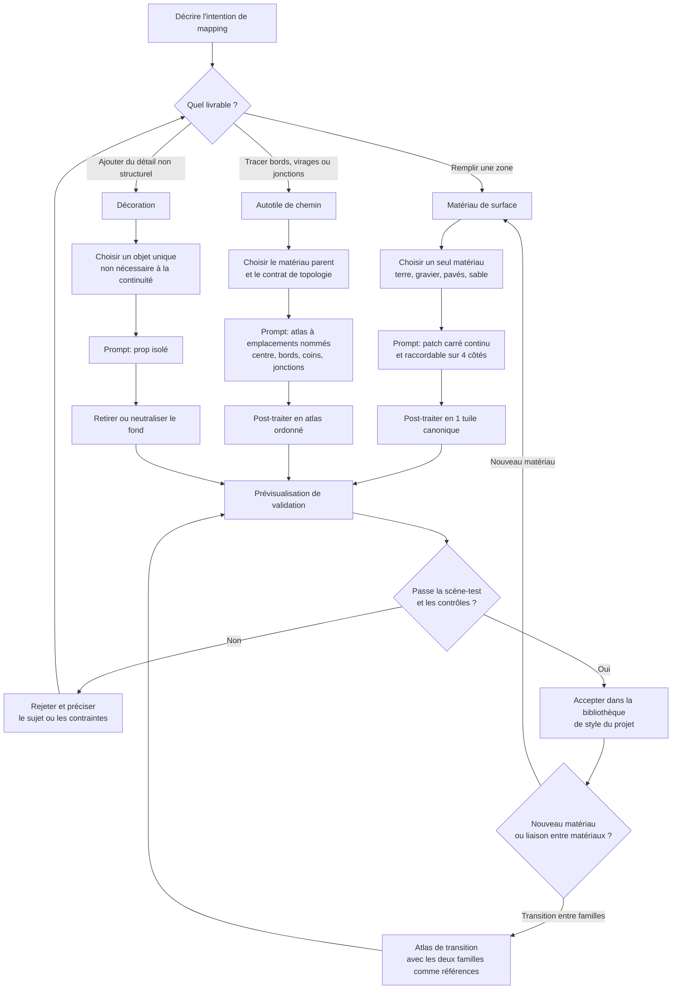

# Pipeline de génération et validation des tilesets

**Feature**: 022-ai-tile-generation  
**Statut**: proposition de refonte du contrat de génération.

## Décision produit

Une image générée ne représente pas toujours le même objet de mapping. Le
pipeline distingue donc trois livrables dont les prompts, la géométrie, le
post-traitement et les tests sont différents :

- **Matériau de surface** : une tuile carrée, répétable sur elle-même (terre
  tassée, gravier, pavés, herbe, sable). Sa forme de chemin est créée par le
  pinceau ou par un autotile ; elle n'est pas dessinée dans l'image.
- **Autotile de chemin** : un atlas à topologie connue, composé de centre,
  bords, coins et jonctions. Il sert à tracer les contours, virages et
  intersections d'un matériau de chemin donné.
- **Décoration** : un objet isolé placé au-dessus d'un sol (ornière, caillou,
  flaque, touffe d'herbe). Elle ne doit pas porter la responsabilité de la
  continuité du chemin.

Un besoin « trails, paved paths, roads » n'est donc pas un sujet de génération
valide : il doit être décomposé en un matériau concret (par exemple terre
tassée ou pavés) et, si nécessaire, en un autotile qui décrit sa topologie.

## Contrats de génération

### Matériau de surface

Le sujet doit désigner **un seul matériau** et son état : « terre sèche
tassée », « gravier gris fin », « petits pavés médiévaux irréguliers ».
Le modèle reçoit un patch sans bord, objet, marquage routier ni forme de
chemin. Il est licite d'autoriser les éléments intrinsèques au matériau : les
pavés et petits joints sont autorisés pour des pavés ; les gros rochers restent
interdits pour une terre tassée.

Le contrat de sortie est une unique tuile de `tileSize × tileSize`. La réponse
brute peut être carrée et de définition supérieure ; le post-traitement est
responsable du recadrage, de la mise à l'échelle pixel-art et de l'encodage PNG.
Il ne découpe pas un patch continu en 64 prétendues textures autonomes.

### Autotile de chemin

Un autotile appartient à un matériau parent et ne prétend pas représenter tous
les chemins. Son contrat définit, avant la génération, la position de chaque
variante (centre, bords N/E/S/O, coins externes et internes, jonctions T et
croix ; variantes optionnelles documentées). La grille sert ici à la géométrie
de l'atlas et est donc autorisée dans le contrat de sortie ; le modèle ne doit
pas dessiner de séparateurs visibles.

Chaque cellule est validée contre ses voisines attendues, et non contre elle-même.
Un bord de chemin n'est pas censé s'auto-raccorder comme un matériau de sol.
Le premier incrément peut exposer un sous-ensemble documenté (centre, quatre
bords, quatre coins) ; l'UI ne doit jamais proposer de jonction absente comme
si elle était disponible.

### Décoration

Les décorations sont indépendantes du matériau et de sa topologie. Elles peuvent
être générées après qu'un sol a été accepté, afin de reprendre son langage
visuel, mais elles ne font pas partie de l'autotile.

## Protocole manuel de qualification

Chaque candidat est conservé avec ses composants de prompt, son brut et son
résultat post-traité. Un candidat est évalué uniquement dans la scène-test
commune du projet, à l'échelle de jeu :

1. Répéter un matériau dans une zone 8×8 et inspecter les quatre raccords et
   les répétitions visuellement saillantes.
2. Pour un autotile, peindre une ligne horizontale et verticale, quatre virages,
   une zone large, puis les jonctions prévues par le contrat.
3. Poser le résultat contre herbe, eau, mur ou matériau réellement voisin lorsque
   cette transition fait partie du catalogue visé.
4. Vérifier la lisibilité au zoom de jeu, la cohérence de palette, de lumière,
   d'épaisseur de contour et de densité de détail avec une famille déjà acceptée.
5. Accepter seulement les résultats dont aucune couture, tuile manquante,
   répétition dominante ou frontière incohérente n'est visible. Sinon, noter le
   défaut observé dans la tentative puis régénérer avec un sujet ou une
   contrainte plus précis.

Le protocole est outillé : le debugger enregistre les paramètres d'entrée de
chaque génération et le lab rejoue des matrices de variantes avec métriques
comparables. Voir [test-plan.md](./test-plan.md).

La suite minimale de calibration contient au moins : terre tassée, gravier,
pavés, herbe et eau ; un autotile de chemin pour un seul de ces matériaux ; une
transition sol/eau ; et une décoration. Elle évite de valider le pipeline sur
un seul exemple favorable.
